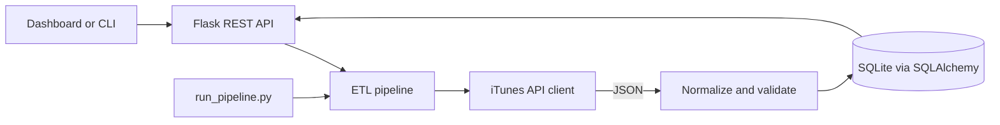

[README.md](https://github.com/user-attachments/files/33889863/README.md)
# SoundPulse

SoundPulse is a small music-metadata analytics project for demonstrating a real
ETL workflow with Python. Its Flask backend collects song metadata from the
public iTunes Search API and stores it in SQLite; a React dashboard reads those
stored records. No API results or dashboard metrics are fabricated.

## Architecture



The backend is separated into routes, an API client, a transformation step,
and the pipeline orchestrator. The frontend is built with React, TypeScript,
Vite, Tailwind CSS, Recharts, and Lucide.

```text
soundpulse/
  backend/
    app/api/          Flask REST endpoints
    app/services/     iTunes client, normalization, and ETL pipeline
    app/models.py     Track and PipelineRun persistence
    tests/            API, client, transform, and pipeline tests
  frontend/
    src/api.ts        Typed HTTP client
    src/components/   Reusable analytics chart
    src/App.tsx       Overview, data explorer, and run history
```

## MVP plan

1. **Backend and tests (done):** Flask API, iTunes integration, ETL pipeline,
   SQLite persistence, CLI, and focused tests.
2. **Frontend (done):** responsive overview, data explorer, and pipeline history
   connected to the real API.
3. **Presentation:** setup polish, final documentation, and a short demo script.

## Requirements and setup on Windows

- Python 3.10 or newer
- Node.js 20 or newer

From the `soundpulse` directory:

```powershell
py -3 -m venv .venv
.\.venv\Scripts\Activate.ps1
python -m pip install -r backend\requirements.txt
Copy-Item backend\.env.example backend\.env
```

To start the backend:

```powershell
Set-Location backend
python run.py
```

The API listens on `http://127.0.0.1:5000`. SQLite data is created in
`backend\instance\soundpulse.db`. The `.env` file is optional; defaults work
without external credentials.

Run a real collection from another terminal:

```powershell
Set-Location backend
python run_pipeline.py --query "Daft Punk"
```

The command calls the iTunes Search API. An internet connection is required for
collection; the REST API and tests can run without the external service.

Start the frontend in a separate terminal:

```powershell
Set-Location frontend
npm install
Copy-Item .env.example .env
npm run dev
```

Open the Vite URL printed in the terminal (normally `http://localhost:5173`).
The backend must be running for dashboard data and collection actions. The UI
shows an explicit connection/error state if it cannot reach the API.

## API endpoints

All endpoints are under `/api/v1`:

| Method | Endpoint | Purpose |
| --- | --- | --- |
| GET | `/health` | Application and database status |
| GET | `/dashboard` | Stored-record and pipeline metrics |
| GET | `/tracks?page=1&per_page=20&q=` | Paginated stored tracks |
| POST | `/pipelines/run` | Start a synchronous collection; JSON body: `{"query":"Daft Punk"}` |
| GET | `/pipelines/runs?page=1&per_page=20` | Paginated execution history |
| GET | `/pipelines/runs/<id>` | Execution details |

## Tests

From `soundpulse`:

```powershell
Set-Location backend
python -m pytest tests
```

Tests use a temporary SQLite database and a fake API client; they do not depend
on network access or mix demonstration data into real collections.

## Configuration

See `backend\.env.example` for the supported environment variables. Do not
commit `.env` files or API credentials.

## Project status

### Done

- Flask application factory and versioned JSON API.
- iTunes Search API client with request timeout and response validation.
- Track normalization, validation, and stable-source-ID deduplication.
- SQLAlchemy persistence and SQLite transaction handling.
- Synchronous CLI and API pipeline execution with persisted run history.
- Dashboard metrics derived from database records.
- Tests for API endpoints and pipeline outcomes.
- React/TypeScript dark dashboard with real stored metrics, chart, search,
  pagination, pipeline execution, and run details.
- TypeScript production build and frontend lint.

### Pending

- Browser-level responsive validation.
- Optional scheduled execution instructions and the five-minute demo script.

## Current limitations

- The first source is iTunes Search; it does not provide Spotify-specific data.
- A collection runs synchronously in the request/CLI process by design.
- SQLite is intended for this small demonstration, not a multi-worker
  production deployment.
